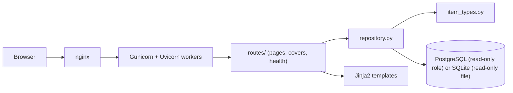

# Architecture overview

biblioteq-web is a server-rendered, read-only web front end for an existing BiblioteQ PostgreSQL or SQLite database.

## Modules

| Module | Responsibility |
| --- | --- |
| `app/config.py` | Settings from `BIBLIOTEQ_*` environment variables; validates the schema name |
| `app/db.py` | SQLAlchemy engine; read-only, timeout and `search_path` set per connection |
| `app/item_types.py` | Registry of item types and their columns; the only source of SQL identifiers |
| `app/repository.py` | All SQL: catalog inspection, search, browse, detail, availability, covers |
| `app/deps.py` | Request dependencies, including the cached catalog |
| `app/routes/` | HTTP endpoints; `sru.py` is an unmounted stub |
| `app/templates/`, `static/` | UI |
| `app/marc/` | Placeholder for MARC conversion (see ADR-0003) |

## Query approach

- At first request the repository inspects the database's columns (`information_schema.columns` for the
  configured schema on PostgreSQL, `pragma_table_info` on SQLite) and builds
  a catalog of usable item types (ADR-0002).
- Search builds one `SELECT` per type and combines them with `UNION ALL`. Each whitespace-separated term
  must match at least one searchable column (`lower(...) LIKE lower(...)`, with `%`, `_` and `\` escaped); terms are bound parameters.
- Browse is search with no terms and a single type. Pages use `LIMIT`/`OFFSET` ordered by title.
- Availability is `quantity` minus `COUNT(*)` of `item_borrower` rows for the item.
- Covers are read from BYTEA columns, MIME type sniffed, and served with an `ETag`.
- An item page is tabs of sections (ADR-0006). The item query loads the title, covers and quantity; each
  non-lazy tab then loads its own sections, and lazy tabs load through `/item/{type}/{id}/{tab}` (ADR-0007).

## Known limits

- Substring `LIKE` scans are adequate for small and medium collections. For larger ones an administrator can add
  `pg_trgm` indexes; the read-only role cannot, and the app does not require them.
- Column names for types other than books follow the BiblioteQ schema but have been tested only against
  the minimal book fixture in `tests/schema.sql`.
